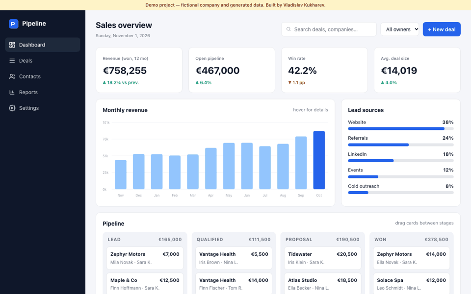

# Pipeline — sales CRM dashboard

> **Demo project.** Brand and data are fictional. Built by Vladislav Kukharev as a portfolio piece.

Admin dashboard for a fictional sales team with generated data.

**Live demo:** https://vk-pipeline-crm-demo.netlify.app · **Code:** https://github.com/Levelupacademybot/pipeline-crm-dashboard

## Features
- KPI cards recalculated from filters
- Animated revenue bar chart with tooltips (pure SVG)
- Drag-and-drop pipeline kanban
- Search, owner filter, sortable and paginated deals table
- Responsive layout, under 30 KB, no framework

## Stack
HTML, CSS, vanilla JavaScript, SVG

## Run
Open `index.html` in a browser.

## License
MIT
